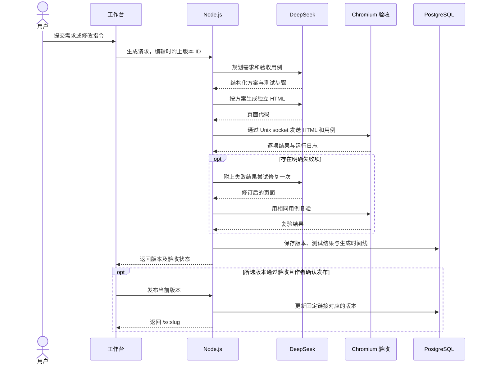

# Atoms Demo 项目说明

[在线评审](http://113.45.177.72:3000/) · [快速开始](../README.md#快速开始本地) · [项目进度](../ROADMAP.md)

## 适用版本

本文适用于包含模板目录、账号项目、固定链接发布和 4×4 试用作品的版本。公开仓库包含这些功能，在线评审实例运行应用代码基线 `b6da3a8`。后续部署记录见 [ROADMAP](../ROADMAP.md)。

## 0 摘要与评审路径

### 0.1 一页摘要

| 项目 | 内容 |
| --- | --- |
| 产品目标 | 把自然语言需求变成可运行、可测试、可迭代和可分享的单页应用。 |
| 主链路 | 登录 → 需求规划 → 生成独立 HTML → Chromium 自动验收 → 保存版本 → 作者发布。 |
| 核心设计 | 先定义可执行验收用例，再生成页面代码。把浏览器执行、版本保存和公开发布分成独立步骤。 |
| 交付形态 | Node.js 24、PostgreSQL 16、原生前端模块、隔离的 Chromium 服务，由 Docker Compose 组织。 |
| 评审入口 | 首页提供计算器、4×4 数字合成游戏和秒表。工作台显示需求、源码、实测结果、版本和发布状态。 |

### 0.2 3 分钟评审路径

1. 打开[窗帘预算计算器](http://113.45.177.72:3000/apps/curtain-budget)，输入 3、2、100 并计算，结果应为 600 元。保存一个方案后刷新，确认方案可加载。也可打开[2048小游戏](http://113.45.177.72:3000/apps/merge-grid)，用方向键或滑动操作棋盘。
2. 打开[模板](http://113.45.177.72:3000/templates)，选择一个模板可以把提示词带入首页。也可直接在首页输入「做一个秒表，支持开始、暂停、继续和归零」。游客发起生成时，输入会保留。注册时按提示选择图案，已有账号可用用户名和密码登录。
3. 在工作台观察五个阶段。生成完成后，打开「自动测试」查看逐项结果，切到「应用预览」手动操作。用「我的项目」查看作品的发布状态、版本数量及最新版本的验收通过率。

模型生成完成后，可继续核对版本和分享。对秒表输入「给当前秒表增加计次功能，保留现有操作」，在「版本历史」对照两版。发布通过验收的版本，在访客窗口验证链接。选中另一通过验收的版本并更新发布，检查链接保持一致。下线后，刷新访客窗口应显示「应用已下线」。

## 1 产品定位与能力范围

Atoms Demo 面向能在浏览器里独立完成的应用，例如计算器、习惯打卡、秒表和小型交互游戏。生成结果采用单文件 HTML，包含样式和脚本，便于在工作台调试、通过链接展示和下载使用。

| 应用构建能力 | 当前实现 |
| --- | --- |
| 从需求开始 | 使用一句话或从模板载入提示词。模板目录的三个项目来自 2026-11-23 的 GitHub Star 快照，提示词可继续编辑。 |
| 生成与迭代 | 基于初始需求或选中版本生成完整 HTML。缺少 DeepSeek Key 时，内置模式覆盖计算器、数字合成游戏和秒表等已支持的需求。 |
| 验证可操作性 | 模型先给出可执行用例，Chromium 实际操作并检查结果。工作台同时支持手动试用和查看代码。 |
| 交付与访问控制 | 通过验收的版本可手动发布或下载。作者控制链接对应的发布版本，以及何时下线。 |

## 2 总体架构与关键流程

### 2.1 技术栈

| 层 | 职责 | 源码 |
| --- | --- | --- |
| 浏览器界面 | 首页、模板、工作台、账号项目列表、分享页 | [public/](../public/) |
| Node.js HTTP 服务 | 登录、请求校验、生成编排、进度流、发布和静态资源 | [server.js](../src/server.js) |
| 生成模块 | DeepSeek 规划、编写与修复 HTML。内置模式用结构化规格和现有运行时代码生成页面。 | [agent.js](../src/agent.js)、[generate.js](../src/generate.js) |
| 浏览器验收服务 | 校验协议、运行真实 Chromium、返回检查状态和日志 | [acceptance.js](../src/acceptance.js)、[qa-worker.js](../src/qa-worker.js) |
| PostgreSQL 16 | 账号、会话、项目版本、发布状态和工具记录 | [store.js](../src/store.js) |

### 2.2 一次生成或编辑



生成请求使用 NDJSON 流逐行返回阶段和耗时。工作台将状态呈现为「需求规划 → 代码生成 → 测试 → 验收 → 完成」，修复会显示在执行记录里。取消生成会关闭流，并向模型和浏览器任务传递取消信号。

## 3 关键设计

### 3.1 自动验收与修复

1. 模型给出 1–8 条需求和 2–8 条声明式用例。每条用例至少断言一个可观察结果，全批至少有一条用例在操作控件后断言结果。
2. 通过 `data-testid` 定位控件。测试协议支持点击、填值、选择、按键、刷新，以及断言文本、输入值、可见性、数量和变化。模型生成的 HTML 上限为 128 KiB。
3. Chromium 为每条用例创建独立浏览器上下文，并增加一条运行检查，记录脚本错误、控制台错误和不符合预期的外部请求。明确失败会触发一次修复尝试，生成可用修订后按同一批用例复验。超时或验收服务不可用时，结果标为「未完成」。
4. 运行检查和所有用例通过后，版本可发布和导出。最终未通过的模型版本作为私有草稿保存，作者可诊断或继续编辑。已发布链接仍指向上次发布的通过版本。

模板模式对内置运行时代码执行自身的回归检查。两个模式都将结果呈现在工作台。所选版本须通过全部验收检查后才可发布。

### 3.2 版本与发布

| 操作 | 结果 |
| --- | --- |
| 生成或编辑 | 保存独立版本及生成时间线，编辑时记录父版本。默认由账号在工作台查看。 |
| 查看历史 | 可打开旧版并对照各版本的预览、代码和自动测试。 |
| 首次发布 | 为作品申请 `/s/:slug`，指向所选的通过验收版本。 |
| 更新发布 | 固定链接继续有效，公开内容切换到所选版本。 |
| 下线或重新发布 | 下线后访客收到 HTTP 410，重新发布继续沿用原链接。 |
| 兼容旧版作品 | 历史 `/apps/:id` 仍可访问。作者纳入发布管理后，旧链接按当前发布状态跳转或返回下线页。 |

### 3.3 账号和工具记录

注册使用一次性图像验证码。密码通过带盐的 scrypt 保存，数据库存会话令牌的哈希。登录后可从「我的项目」按作品查看版本和发布概况。列表中的通过率为最新版本已通过的检查数除以检查总数，按百分比取整。

工作台和分享页通过受限的存储接口接收产物的 `localStorage` 调用。可同步的记录按账号和作品保存，工作台和登录分享页可跨设备恢复。访客视图使用单独的浏览器存储。并发更新用修订号检查，遇到冲突时提示刷新。

## 4 数据模型与接口契约

### 4.1 PostgreSQL 数据表

| 表 | 保存内容 |
| --- | --- |
| `users` | 用户名、规范化账号标识、密码盐和哈希。 |
| `sessions` | 会话标识的哈希、所属账号和到期时间。 |
| `challenges` | 会话绑定的一次性图像验证码及到期时间。 |
| `projects` | 每个版本的需求、HTML、来源、验收结果及可选的父版本、计划和时间线。 |
| `publications` | 作品根版本、固定 slug、线上版本及发布状态。 |
| `tool_state` | 按账号和作品保存的工具记录及修订号。 |

### 4.2 主要接口

| 方法与路径 | 用途 |
| --- | --- |
| `GET /health` | HTTP 存活探测。 |
| `GET /api/bootstrap` | 当前登录态、引擎、试用成品和最近记录。 |
| `GET /api/challenge` | 创建注册所需的一次性验证码。 |
| `POST /api/register`、`/api/login`、`/api/logout` | 注册、登录和退出。 |
| `POST /api/generate` | 登录后生成或修改应用，响应为 NDJSON。 |
| `GET /api/projects`、`GET /api/projects/:id` | 获取账号作品列表及版本详情。 |
| `POST /api/projects/:id/publication` | 作品作者发布、更新发布或下线。 |
| `GET /s/:slug`、`/s/:slug/content`、`/s/:slug/download` | 读取当前公开作品、沙箱内容和下载文件。 |
| `GET/POST /api/projects/:id/state`、`/api/shared/:slug/state` | 读取或同步当前账号的作品数据。 |

## 5 隔离、可靠性与部署

- **应用预览**使用隔离源 iframe 和内容安全策略。宿主界面通过受限消息桥接存储，生成脚本只在浏览器执行。
- **验收容器**使用无外部网络的 Compose 配置，通过 Unix socket 与应用通信。数据库和模型凭据由应用服务读取。Chromium 继续使用沙箱，并通过仓库中的 seccomp 配置启动。
- **公开访问**由应用按当前发布状态检查。生成提交需要登录，同账号一次处理一条生成请求。限流和运行中的请求状态保存在单个应用进程内。
- **运行与恢复**通过 `postgres_data` 命名卷保存数据库。反向代理应保留 Host，并按外部 HTTPS 地址配置 `PUBLIC_ORIGIN` 以启用 Secure Cookie。当前评审地址使用 HTTP，验收时可用专门的测试账号。[部署命令和环境变量](../README.md#部署docker-compose)

## 6 完成度与已知边界

| 交付能力 | 可验证的结果 |
| --- | --- |
| 从提示词到应用 | 登录后生成，工作台展示方案、阶段、HTML 和可操作预览。 |
| 自动测试与修复 | 在「自动测试」逐项查看实测结果。明确失败会触发一次自动修复，未通过版本保留为私有草稿。 |
| 版本和固定发布链接 | 选择版本、发布、在同一 URL 更新、以访客预览及下线。 |
| 账号恢复 | 退出后重新登录，可在工作台和「我的项目」查看账号版本。支持记录的工具可跨设备读写。 |
| 产品范围 | 支持离线单页。需服务器逻辑、外部 API 或实时协作的需求超出当前生成范围。 |
| 验收范围 | 浏览器门禁针对声明式 DOM 用例和运行日志，默认视口 1280×860。视觉效果、触屏手势和窄屏布局需要专项或人工验证。 |
| 运行规模 | 当前部署为单实例，生成进度和限流按进程计算。 |

## 7 质量证据与复现

### 7.1 测试矩阵

2026-11-24，本地新版在 PostgreSQL 16 和真实 Chrome 上完成全量回归，`npm test` 通过 11/11 项。模型上游使用模拟服务。

| 检查 | 覆盖证据 |
| --- | --- |
| 服务端集成 | 游客权限、三项内置成品、模板目录、账号和会话、兼容模型与兜底、取消、版本发布、旧链接和工具数据隔离。[测试源码](../test/studio.test.js) |
| 生成与浏览器验收 | 模拟 DeepSeek 规划和生成协议，以真实 Chromium 操作页面，覆盖通过、修复、草稿权限和版本。[测试源码](../test/studio.test.js) |
| 工作台浏览器回归 | 使用真实 Chrome 检查登录弹窗、发布、第二会话恢复历史及下线。[测试源码](../test/studio.test.js) |
| 公网验证记录 | 项目路标记录了真实模型生成、部署健康检查、用户流程、移动端触控及 HTML 导出。[历次验证](../ROADMAP.md#最近验证) |

### 7.2 复现命令

安装依赖，并将 `TEST_DATABASE_URL` 指向独立 PostgreSQL 测试库。完整回归还需要设置 `TEST_CHROME` 指向本机 Chrome。在另一个终端中先启动本地浏览器验收服务。以下使用短 Unix socket 路径，`QA_CHROMIUM_PATH` 需预先指向可用的 Chrome 或 Chromium。

```bash
QA_SOCKET_PATH=/tmp/atoms-qa-local.sock node src/qa-worker.js
```

在测试终端运行。

```bash
TEST_QA_SOCKET=/tmp/atoms-qa-local.sock npm test
```

缺少 `TEST_QA_SOCKET` 时会跳过 DeepSeek 浏览器验收用例，缺少 `TEST_CHROME` 时会跳过工作台浏览器回归。自动化测试使用本地模拟模型服务，在线 Demo 可用来验证真实模型。

### 7.3 已记录的真实模型样例

下列表格记录的是项目路标在 2026-11-23 留存的验收结果。试用成品与这些真实模型产物各有独立入口。

| 作品 | 验收结果 |
| --- | --- |
| [窗帘预算计算器](http://113.45.177.72:3000/apps/-kqrQg_1igXWeAzp) | 5/5 |
| [原创数字合成游戏](http://113.45.177.72:3000/apps/CePNrII-1QhppOjD) | 4/4 |
| [秒表](http://113.45.177.72:3000/apps/X8uLZ9i2tUV5WJes) | 5/5 |
| [习惯打卡](http://113.45.177.72:3000/apps/8vmhD_EEi32_69me) | 4/4，刷新后保留记录 |
| [秒表计次修改版](http://113.45.177.72:3000/apps/fBH52U0rvwp-XWib) | 5/5 |

## 附录

- 启动和配置见 [README](../README.md)，部署版本与复测记录见 [ROADMAP](../ROADMAP.md)。
- Chromium 容器 seccomp 配置来自 [Playwright v1.65.1](https://github.com/microsoft/playwright/blob/v1.65.1/utils/docker/seccomp_profile.json)，采用 Apache-2.0 许可。[仓库许可文件](../deploy/LICENSE.chromium-seccomp)
